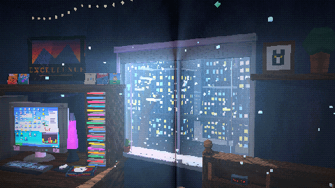
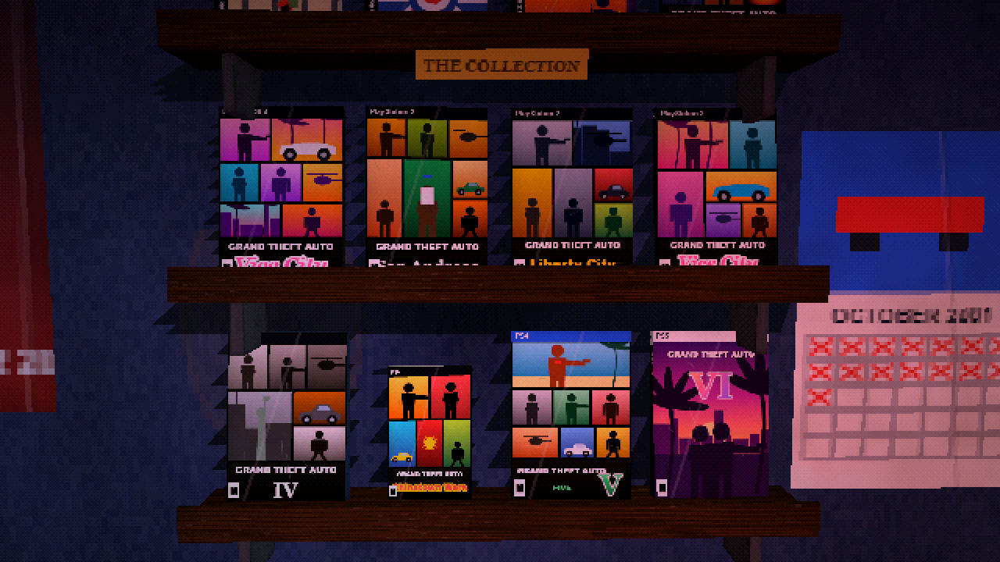
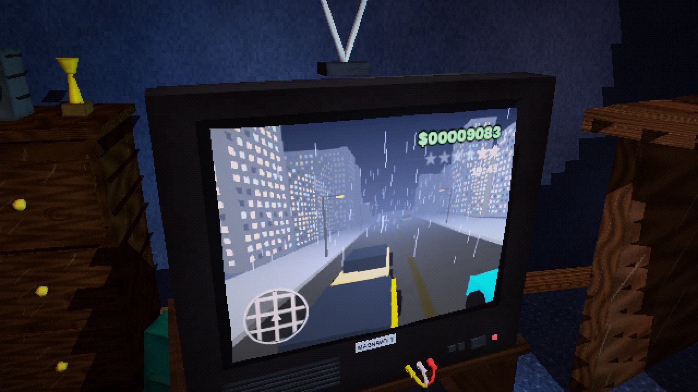
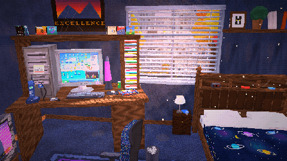
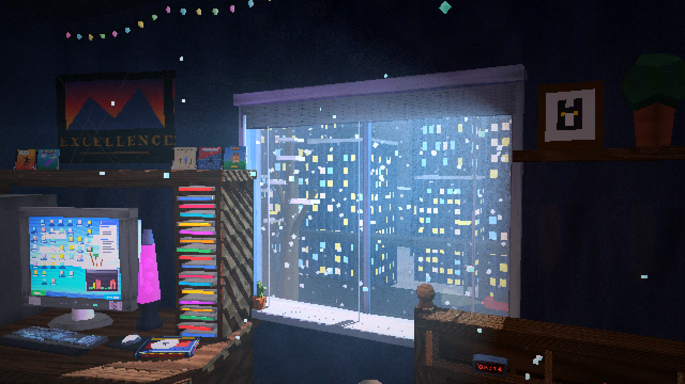
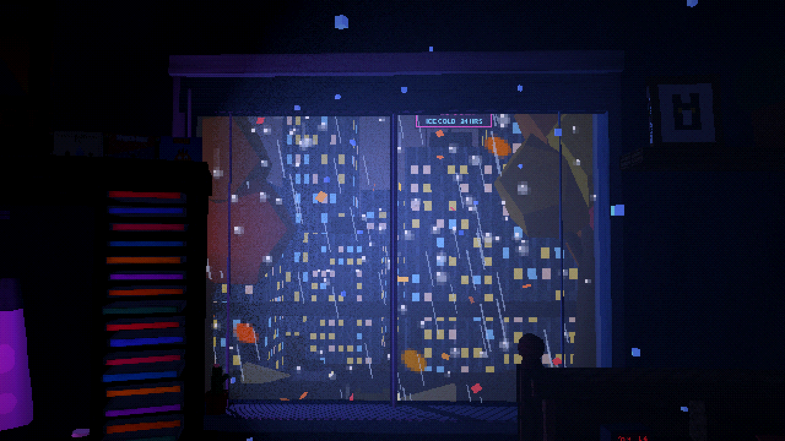
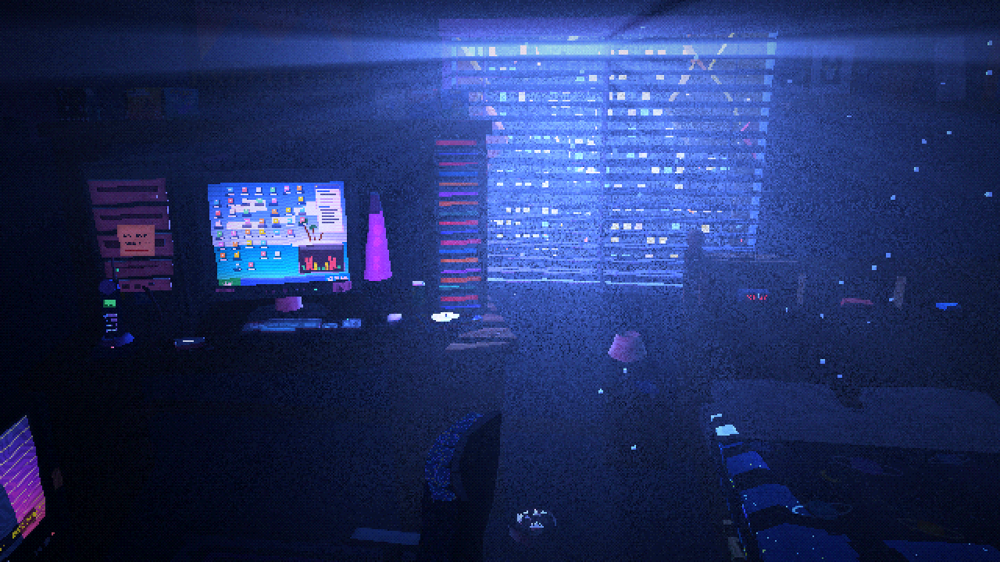

<div align="center">


<br>

[](../../releases/latest)
[](../../releases)
[](../../releases)


### *Your room. Your clock. Your weather. 1999 forever.*

</div>

---

## 🌙 About

**PS1 Bedroom** is a cozy ambience app styled like a late-90s PlayStation game: wobbly low-poly 3D, dithered 15-bit colour, and real volumetric light rays slicing through the blinds.

Put it on in the background while you study, work or fall asleep. The room **follows your real clock**: the sun rises and sets on a true path across the sky, tonight's real moon phase hangs over the city, and the skyline's windows light up in the evening and go dark at 4 AM. Hook it up to **your city's live weather** and it rains when it rains outside.

Every corner has its own sound, mixed in 3D: the hum of the CRT, the ceiling fan, rain on the window, crickets, a train rumbling past, the muffled TV down the hall. And almost everything can be tapped: the TV, the PlayStation and its buttons, every game on the shelves, the lamp, the boombox, the blinds and the door.

<div align="center">

<br><sub><i>A whole day passing outside the window: sunrise, daylight, golden hour, city lights</i></sub>
</div>

---

## ⬇️ Download & install

<table>
<tr>
<td width="50%" valign="top">

### 📱 Android
1. Grab **`PS1-Bedroom-v1.1.apk`** from the **[latest release](../../releases/latest)**.
2. Open it on your phone and tap **Install**. Allow installs from your browser / file manager if asked.
3. If Play Protect warns you (it's not from the Play Store), tap **Install anyway**.
4. Tap the screen to boot up. 🎮

Updates install right over the old version and keep your settings.

</td>
<td width="50%" valign="top">

### 💻 Desktop browser
1. Download **[`src/ps1_bedroom.html`](src/ps1_bedroom.html)**.
2. Double-click it to open it in Chrome, Edge or Firefox.
3. Click **PRESS START**.

Needs internet the first time to load its 3D and audio libraries. Controls: drag to look, scroll to zoom, WASD to walk.

</td>
</tr>
</table>

---

## ✨ Features

### 🌦️ Real sky, real weather

<table>
<tr>
<td width="50%"><br><sub><b>Thunderstorm</b> with forked lightning and rolling thunder</sub></td>
<td width="50%"><br><sub><b>Blizzard</b>: sideways snow, frosted glass, string lights glowing</sub></td>
</tr>
</table>

- ☀️ **Real-time sun and moon** on true astronomical paths, with real sunrise and sunset times for the date (or your city). The room's light changes from deep orange to warm daylight to cool moonlight.
- 🌕 **Tonight's actual moon phase.** Pick a *Cinematic* moon that glides low across your window all night, or *Real astronomy*.
- 🕰️ **Time modes:** Live clock · Pick a time (Blue Hour, Sunrise, Golden Hour, Dusk...) · Time-lapse (a whole day in 5, 20 or 60 minutes).
- 🌧️ **15 weathers:** Clear, Partly Cloudy, Overcast, Windy, Drizzle, Rain, Downpour, Sun Shower (with a rainbow!), Thunderstorm, Heat Lightning, Snow Flurries, Snowfall, Blizzard, Light Mist, Heavy Fog.
- 📡 **Live weather** for your city, or an **Auto** mode that drifts naturally with the season.
- 🍂 **Seasons** follow today's date: spring blossoms, summer fireflies, autumn leaves, winter snow caps.

### 🌌 Five skies

<div align="center">

<br><sub><b>Natural · Northern Lights · Meteor Shower · Blood Moon · Vaporwave</b></sub>
</div>

### 🎮 A PlayStation full of games, including every GTA

<table>
<tr>
<td width="50%"><br><sub><b>The Collection</b>: all 12 Grand Theft Autos, each in its console's case</sub></td>
<td width="50%"><br><sub><b>GTA VI</b> rendered in real 3D on the CRT: a sunset cruise up the beach</sub></td>
</tr>
<tr>
<td width="50%"><br><sub><b>GTA III</b>: rainy Liberty City at night</sub></td>
<td width="50%" valign="top">

- 🕹️ Grab any game off the shelf and put it in the PlayStation: the lid pops, the discs swap, and it boots with its own title screen, gameplay and soundtrack.
- 🚗 Top-down chases for GTA, London 1969, GTA 2 and Chinatown Wars. **Real 3D drives** for III, Vice City, San Andreas, the Stories, IV, V and VI.
- 📼 Plus Tony Hawk's, Spyro, Final Fantasy IX, Spider-Man, Crash Bash, Driver 2 and more.
- 📺 TV channels (anime, the 90s weather channel with your *real* forecast, VHS horror, cartoons, music videos), a PC with five screens, and a boombox radio.

</td>
</tr>
</table>

### 🛏️ A room to live in

<table>
<tr>
<td width="50%"><br><sub>Roll the <b>blinds</b> all the way up for uninterrupted light rays</sub></td>
<td width="50%"><br><sub>A <b>winter night</b> with rainbow string lights</sub></td>
</tr>
<tr>
<td width="50%"><br><sub><b>Rainy dusk</b> from the window seat</sub></td>
<td width="50%"><br><sub><b>Midnight</b>: moonlight through the slats</sub></td>
</tr>
</table>

- 🚶 **Walk** around (joystick on phones), **sit** in the rolling chair (TV, desk or window), or **lie in bed**.
- 💡 Ceiling fan and light, nightstand lamp, string lights (warm or rainbow), lava lamp, AC unit, a door into the hallway.
- 🏙️ Outside: a two-layer skyline, rooftop neon billboards, traffic with headlights after dark, and an elevated train.

### 🛠️ Made for leaving on

| | |
|---|---|
| ⏾ **Sleep timer** | 15–90 minutes. Everything fades out gently and the screen can turn off. |
| 🔊 **Background play** | On Android it keeps playing with the screen off or in other apps. |
| 🔒 **Lock screen** | Media controls (play, pause, sleep 30) right on your lock screen. |
| 🧩 **Widgets** | *My Window* (a live pixel-art view outside your window with the clock and weather) and *Controls*. |
| 📷 **Photo mode** | Hide everything and save a crisp screenshot to your gallery. |
| 🔋 **Battery saver** | Lower resolution and 30 fps for all-night sessions. |
| 🎨 **Looks** | Signature · Raw PS1 · Warm VHS · Cool Night · Neon Dream · Noir |
| 💾 **Remembers** | Your time, weather, lights, volumes and settings between sessions. |
| 📱 **Any screen** | Portrait or landscape, phone or desktop. |

---

## 📜 Changelog

The full history is in **[CHANGELOG.md](CHANGELOG.md)**, and inside the app under **Menu → About → Changelog**.

<details>
<summary><b>v1.1: The living room update</b> (latest)</summary>

<br>

- Real-time sun and moon, real moon phases, sunrise and sunset for your city
- Time modes: Live, Pick a time, Time-lapse
- 15 weathers, live weather by city, auto-changing weather
- Five sky styles; clouds, stars, the Milky Way, shooting stars, planes and birds
- A bigger city with neon billboards, an elevated train and lights after dark
- Blinds roll all the way up · string lights · windowsill plants
- The complete GTA collection, with 3D gameplay on the CRT
- PlayStation-style start screen, a new interface, saved settings, sleep timer, photo mode, quality presets and Looks
- Android: background playback, lock-screen controls, home and lock-screen widgets, portrait and landscape
- Sharper TV, higher chair eye level, brighter days, no more repeating textures

</details>

<details>
<summary><b>v1.0: First full release</b></summary>

<br>

- Fixed crackling audio on Android · in-app changelog · one-click APK build

</details>

<details>
<summary><b>v0.1 – v0.8: Alpha & beta</b></summary>

<br>

- **0.8** · The first Android app with touch controls
- **0.7** · The big room update: hallway, door, props, new channels, game swapping, weather effects
- **0.6** · Worn textures and real-looking PS1 game cases
- **0.5** · PlayStation overhaul with a working lid, buttons, boot screen and games
- **0.4** · Full sound overhaul
- **0.3** · Polish pass
- **0.2** · Bug fixes
- **0.1** · The original room

</details>

---

## 🔧 Build it yourself

<details>
<summary>How the project is laid out and how to make an APK (Windows)</summary>

<br>

```
src/ps1_bedroom.html   ← the whole app (one file: 3D, sound, UI)
android/               ← tiny WebView wrapper: service, widgets, bridge
Build APK.bat          ← double-click to build releases/PS1-Bedroom-vX.Y.apk
CHANGELOG.md
```

1. Edit `src/ps1_bedroom.html`. Bump `APP_VERSION` and add an entry to `CHANGELOG`.
2. Install Java 17 and the Android build-tools and platform jar into `%LOCALAPPDATA%\PS1BedroomBuildTools`.
3. Put your own signing keystore in `android/signing/` (not included).
4. Run **`Build APK.bat`**.

No Gradle, no Android Studio: the script runs `aapt2 → javac → d8 → zipalign → apksigner` directly.

</details>

---

<div align="center">

<sub>Built with <a href="https://threejs.org/">three.js</a> and <a href="https://tonejs.github.io/">Tone.js</a> · live weather by <a href="https://open-meteo.com/">Open-Meteo</a> (only the city name you type is sent)</sub>

<sub>An unofficial fan project, not affiliated with Sony Interactive Entertainment, Rockstar Games or any other company. Game boxes and covers are hand-drawn tributes.</sub>

<br>

**🌙 Sweet dreams. 🎮**

</div>
