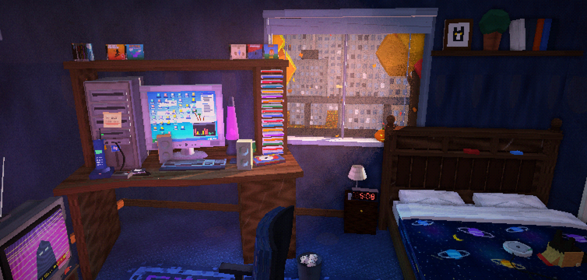
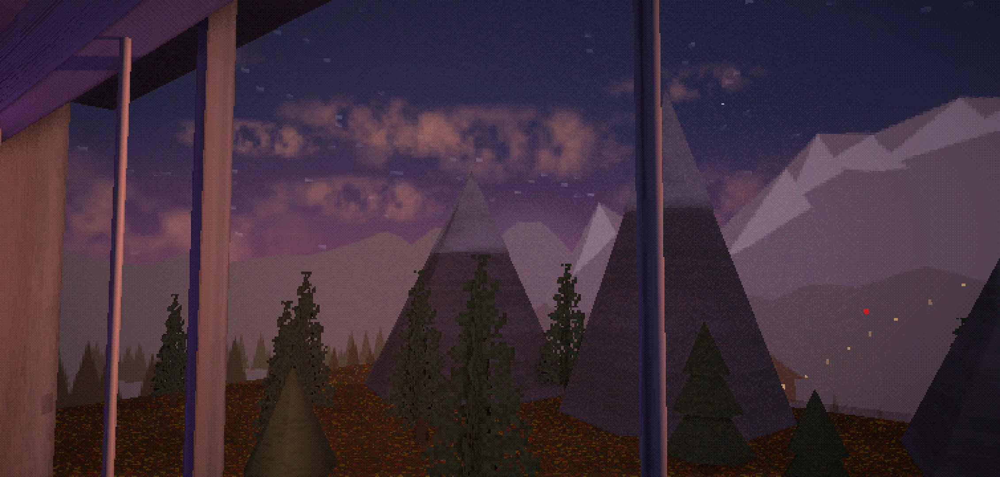
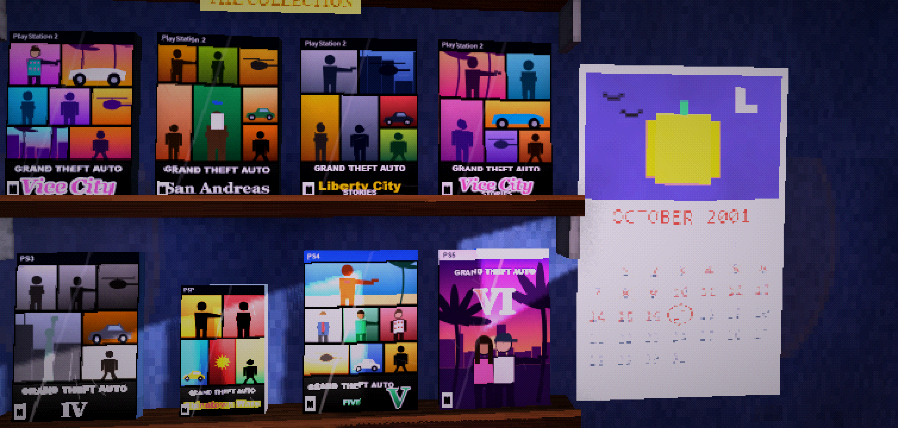
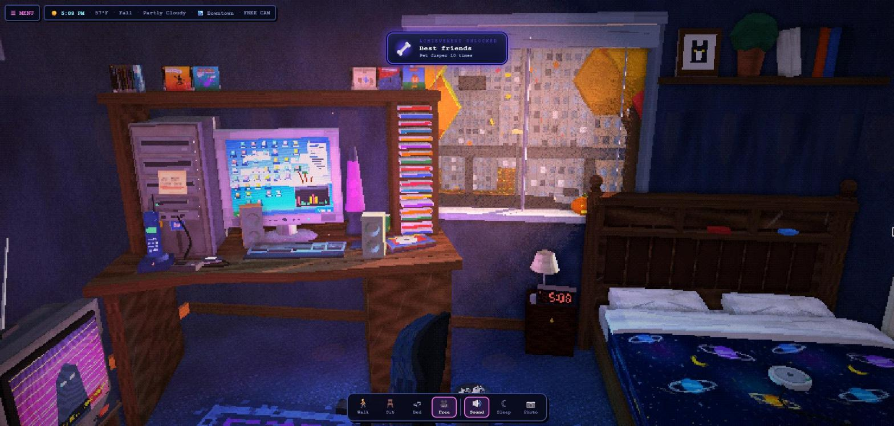
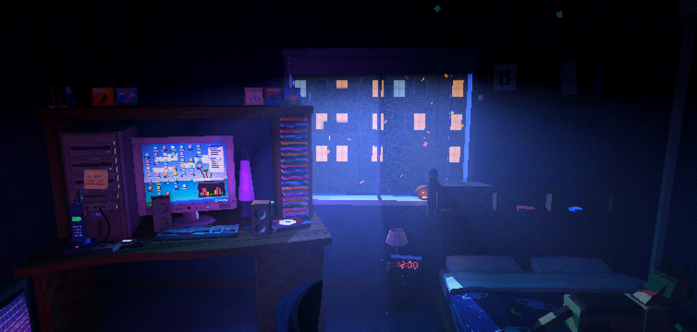

 

<h3><i>Your room. Your clock. Your weather. 2001 forever.</i></h3>

A cozy ambience app that looks like a PlayStation game from 2001. Leave it on while you study, work, game or fall asleep.

<a href="#-new-in-135--clear-skies">What's new</a> &nbsp;·&nbsp; <a href="#-the-room">The room</a> &nbsp;·&nbsp; <a href="#-15-places-outside">Places</a> &nbsp;·&nbsp; <a href="#%EF%B8%8F-get-it">Download</a> &nbsp;·&nbsp; <a href="#-made-for-android">Android</a> &nbsp;·&nbsp; <a href="#-changelog">Changelog</a> &nbsp;·&nbsp; <a href="../../wiki">📖 Wiki</a>

 

Golden hour downtown. The clock by the bed shows the room's real time.

 

> [!IMPORTANT]
> ### 📣 Coming October 21, 2026: a true native Android app
> PS1 Bedroom is being rebuilt from scratch in **Kotlin + OpenGL ES**: the same room 1:1, with **sleep-friendly audio** (no more crackle or clipping overnight), a **cooler, lighter renderer** and better battery life for all-night use.
> **Releases October 21, 2026** here on GitHub, and comes to **Google Play before the end of 2026**. The old web-view APKs have been taken down because they weren't optimized enough; until the native app lands, play in your browser.
> [Read the announcement →](../../issues/29) · [Follow the `native` branch →](../../tree/native)

## 🆕 New in 1.3.5 — Clear Skies

<table>
<tr>
<td width="50%" valign="top"> <b>🌌 A whole new sky</b> One seamless dome around the world, with the sun, moon, stars and clouds drifting all the way round. No more seams or corners.</td>
<td width="50%" valign="top"> <b>📅 A calendar that works</b> The real month, today circled, past days crossed off, and a little pixel-art picture for every month.</td>
</tr>
<tr>
<td width="50%" valign="top"> <b>🏆 Achievements you can feel</b> A trophy card, pixel confetti and a fanfare, with a different colour, move and tune for each one. Tap the top bar to flip time, weather, season and place.</td>
<td width="50%" valign="top"> <b>🕰️ A clock you can read</b> A jumbo LED clock radio on the nightstand. Tap it for the sleep timer, focus timer and sunrise alarm.</td>
</tr>
</table>

<b>Everything else in 1.3.5</b>

 

- ✨ **Flicker fixed for good**: layered things (the TV border, posters, the album cover, the rug, windows on the houses outside) no longer fight, and small far-away things no longer vanish
- 📺 **PS1 look on YouTube**: the video wobbles with the TV and gets the room's chunky pixels (Menu → Display)
- 🔊 **New default sound mix**: your TV louder than the one down the hall, softer rain peaks
- 🔋 **Cooler phones**: 20 fps after 2 minutes untouched, fewer redraws, lighter audio
- 🐕 Jasper's neck, the ceiling fan brackets, the game shelf, the box fan and lots more fixed

 

## 🌙 The room

<table>
<tr>
<td width="33%" align="center" valign="top">🕰️ <b>Real time, real weather</b> The sun and moon follow your clock on real paths. It rains when it rains in your city. 15 weathers and 5 skies.</td>
<td width="33%" align="center" valign="top">🎮 <b>A PlayStation full of games</b> Put any game from the shelf in the PS1, including every GTA as a hand-drawn tribute.</td>
<td width="33%" align="center" valign="top">📻 <b>Your music on the boombox</b> Your own albums with their cover art, shuffle, repeat and FM stations. Your music never leaves your device.</td>
</tr>
<tr>
<td width="33%" align="center" valign="top">📺 <b>YouTube on the CRT</b> Paste a link, or Share a video to PS1 Bedroom on Android, and it plays on the old TV.</td>
<td width="33%" align="center" valign="top">🐕 <b>Jasper the German Shepherd</b> Naps in the sunbeam, watches TV with you, sleeps on the bed. Pick his coat colours.</td>
<td width="33%" align="center" valign="top">🖥️ <b>A working 2001 PC</b> Instant messenger, WinBeats, Minesweeper and the dial-up screech.</td>
</tr>
<tr>
<td width="33%" align="center" valign="top">😴 <b>Made for falling asleep</b> Sleep mode, a sleep timer that fades everything out, and a sunrise alarm.</td>
<td width="33%" align="center" valign="top">🔊 <b>Sound all around you</b> Rain on the glass, the CRT hum, the fan, crickets, a train going by. Every sound placed in 3D.</td>
<td width="33%" align="center" valign="top">📷 <b>Photo mode and share cards</b> Hide the UI, pick a look (Raw PS1, Warm VHS, Neon Dream, Noir…) and make a postcard of your room.</td>
</tr>
</table>

<table>
<tr>
<td width="50%"> <b>15 weathers</b>, or live weather for your city</td>
<td width="50%"> <b>Real sun and moon</b> paths and tonight's moon phase</td>
</tr>
<tr>
<td width="50%"> <b>Games on the CRT</b>, from the classics to GTA VI</td>
<td width="50%"> <b>Five skies</b>: Natural, Northern Lights, Meteor Shower, Blood Moon, Vaporwave</td>
</tr>
</table>

 

## 🏙️ 15 places outside

<table>
<tr>
<td width="33%"> <b>Skyscraper</b>, 40th floor</td>
<td width="33%"> <b>Arizona</b> at dusk</td>
<td width="33%"> <b>Suburbs</b> in the snow</td>
</tr>
<tr>
<td width="33%"> <b>Beach Boardwalk</b></td>
<td width="33%"> <b>Forest</b> in the mist</td>
<td width="33%"> <b>Neon City</b> in the rain</td>
</tr>
</table>

Downtown · Skyscraper · Neon City · Neighborhood · Suburbs · Backyard · Trailer Park · Arizona · Desert Canyon · Tropical Island · Beach Boardwalk · Lakeside · Forest · Mountains · Countryside Farm

 

## ⬇️ Get it

<table>
<tr>
<td width="50%" valign="top">

### 📱 Android

The Android app is being rebuilt as a **true native app** (Kotlin + OpenGL ES): cooler, lighter and sleep-friendly.

- 📅 **October 21, 2026**: native APK here on GitHub Releases
- ▶️ **Google Play** before the end of 2026

The old web-view APKs were taken down because they weren't optimized enough. Until then, play in your browser (it works on phones too). Follow along on the [`native` branch](../../tree/native).

</td>
<td width="50%" valign="top">

### 💻 Browser

Nothing to install. Or download **`PS1-Bedroom-web-v1.3.5.zip`** from the release and open `index.html`.

**Drag** to look · **scroll** to zoom · **WASD** to walk · tap anything

Also on **[itch.io](https://galloade.itch.io/ps1-bedroom)**.

</td>
</tr>
</table>

 

## 📱 Made for Android

These come back in the native Android app (October 21, 2026).

| | |
|---|---|
| 🔒 **Background play** | Keeps playing with the screen off, with song, artist and cover on the lock screen |
| 🧩 **Widgets** | "My Window" and "Controls" widgets for your home and lock screen |
| 📺 **Samsung DeX** | Turns your TV into a rainy 2001 window |
| 📤 **Share to play** | Share a YouTube video to PS1 Bedroom and it plays on the CRT |
| 🔋 **All-night battery** | Automatic quality, a 30 / 60 / 120 fps setting and an eco idle mode, so it stays cool for hours |
| 🎵 **Your albums** | Add album folders and it reads the track order and cover art. Your music stays on your device |

 

## 🔜 Coming next

- 🔋 More performance work: smoother, cooler phones, no more audio crackle
- 🚪 The hallway comes back

**💡 On the ideas list**

<table>
<tr>
<td width="50%" valign="top">

- 🎮 [Real games to play on the TV and the PC](../../issues/16)
- 🕹️ [PS1 to PS5 consoles with their own boot-ups](../../issues/23)
- ✨ [A start screen that matches your PlayStation](../../issues/24)
- 🐾 [More animals and dog breeds](../../issues/17)
- 🖼️ [Your own photos on the posters](../../issues/18)
- 📻 [Poster options above the boombox](../../issues/19)
- 🫧 [Turn the lava lamp on and off](../../issues/20)

</td>
<td width="50%" valign="top">

- 📺 [Move and hide the YouTube buttons](../../issues/21)
- 🛋️ [Change and move the furniture](../../issues/22)
- 🪟 [Room layout presets](../../issues/25)
- 🎉 [Better decorations and more holidays](../../issues/26)
- 🌧️ [Better raindrops on the glass](../../issues/27)
- 🧱 [Better wall textures](../../issues/28)

</td>
</tr>
</table>

Got an idea? **[Open an issue](../../issues/new)**. Follow along on the **[ideas list](../../issues?q=is%3Aissue+is%3Aopen+label%3Aidea)**, the **[milestones](../../milestones)** and the **[`beta`](../../tree/beta)** branch.

 

## 📜 Changelog

Full history in **[CHANGELOG.md](CHANGELOG.md)** and in the app under **Menu → About**.

<b>v1.3.5 — Clear Skies</b> (latest)

 

New seamless sky dome · working wall calendar · LED clock radio by the bed · tap the top bar to switch time, weather, season and place · achievement unlock animations and fanfares · PS1 look on YouTube · new sound mix · cooler on phones · flicker and vanishing fixed for good · Jasper's neck, ceiling fan, game shelf, box fan and more

<b>v1.3 — Goodnight, Jasper</b>

 

Sleep mode · sunrise alarm · share cards · 18 achievements · daily surprises · Jasper rebuilt with coat colours · muffled living room TV · screen sleeps after the timer · fixes for the TV, YouTube in Photo mode, chair, backpack and audio crackle

<b>v1.2 — Stuff from 2001</b>

 

15 places outside the window · German Shepherd · boombox player with albums and cover art · YouTube on the TV · working PC desktop · VCR tapes · phone and answering machine · traffic and billboards that follow the clock · decorations by date · focus timer · ambient occlusion · per-pixel lighting · sky box · 120 fps option · long-session performance fixes · audio clipping fix

Older versions

 

- **v1.2.1 — TV power** · a big red power button
- **v1.1.4 — Temperature** · °F / °C in the top bar
- **v1.1.3 — Dust in the light** · dust follows the light beam
- **v1.1.2 — Little touches** · live bedside clock
- **v1.1.1 — Fixes** · light rays stay in the window, no more fall crackle
- **v1.1 — The living room update** · real sun and moon, 15 weathers, the GTA collection, Android widgets and lock screen
- **v1.0 — First full release**
- **v0.1 – v0.8** · alpha and beta

 

---

Some props from <a href="https://kenney.nl/assets/furniture-kit">Kenney's Furniture Kit</a> (CC0) · Built with <a href="https://threejs.org/">three.js</a> and <a href="https://tonejs.github.io/">Tone.js</a> · Live weather by <a href="https://open-meteo.com/">Open-Meteo</a>

An unofficial fan project, not affiliated with Sony Interactive Entertainment, Rockstar Games or anyone else. Game boxes and covers are hand-drawn tributes. Your music stays on your device.

 

**Made by Daymion Gallo** · aka **Galloade** · aka **JenZiMiBruh**

🌙 *Sweet dreams.* 🎮

