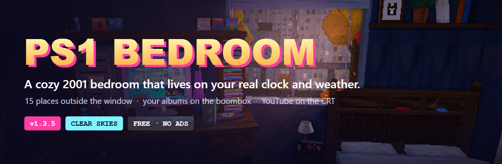

 

# 📱 PS1 Bedroom: Native Android

<h3><i>The same room, rebuilt from scratch as a real Android app.</i></h3>

Kotlin + OpenGL ES 3. No web view, no browser engine. Made to run all night: cool phone, clean sound, long battery.

<a href="#-release-dates">Release dates</a> &nbsp;·&nbsp; <a href="#-why-native">Why native</a> &nbsp;·&nbsp; <a href="#-progress">Progress</a> &nbsp;·&nbsp; <a href="#-changelog">Changelog</a> &nbsp;·&nbsp; <a href="#%EF%B8%8F-how-its-built">How it's built</a> &nbsp;·&nbsp; <a href="../../tree/main">Current web-based app (main)</a>

 

> [!NOTE]
> This is the **`native` branch**: the work-in-progress native Android app. Looking for the app you can play today?
> It's on [**`main`**](../../tree/main): play it in your browser or grab the current Android APK from [Releases](../../releases/latest).

## 📅 Release dates

| | |
|---|---|
| 🚀 **Native Android release** | **October 21, 2026**, here on GitHub Releases |
| ▶️ **Google Play** | **Before the end of 2026** |

When the native app ships, it takes over from the current web-based Android app as **PS1 Bedroom** on your phone. Your room is still your room.

## 🧊 Why native

The current Android app runs the game inside a web view. It works, but a browser engine is a heavy thing to leave running all night. The native app is written for exactly that job.

| | Current app (web view) | **Native app** |
|---|---|---|
| 🌙 **Sound while you sleep** | Synthesised live in the browser: can crackle or clip on long nights | Native mixer in a proper media service: clean all night |
| 🌡️ **Heat** | Browser + WebGL overhead | A renderer that makes **zero garbage per frame**, merges furniture that never moves into a few big draws, and only redraws shadows when something moves |
| 🔋 **Battery** | Frame-rate caps | 60 fps cap → **30 fps after 12 s idle → 20 fps after 2 min**, plus Android's real thermal sensor: the app backs off *before* the phone has to throttle |
| 📦 **Size** | ~600 KB | **~900 KB** so far, with every texture still drawn in code |
| 🎮 **Look** | three.js + PS1 shaders | **1:1 port**: the same vertex wobble, affine textures, dither, light rays and weathering, number for number |

## 🛠️ Progress

The port follows the web version section by section and is checked against it as it goes: same positions, sizes, colours, and even the same weathering map on every surface.

### ✅ Done

- **Engine**: OpenGL ES 3 renderer that mirrors three.js r128, the PS1 shader (vertex snap, affine warp, grime, macro variation), the post pass (ambient occlusion, light rays through the window, colour grade, dither), and the orbit camera with drag, pinch and pan
- **Performance**: frame pacing, idle slow-down, thermal quality steps, static batching, shadow maps only redrawn when needed
- **The room**: walls, floor, ceiling, rug, door with its UNDER CONSTRUCTION sign, baseboard all the way round, light switch, AC unit with a sweeping louvre
- **Window and blinds**: all four blind states with the slat animation; tap to change
- **Real sun and moon**: the light through the window follows the time of day, the season and the moon phase
- **The sky**: dome with time-of-day colours, sunset glow, twinkling stars, Milky Way, sun and moon, drifting clouds; airliners, birds, shooting stars, rainbows
- **The city outside**: 3D towers with day/night facades and roof beacons, highway traffic that follows the clock and weather (police chases, wet roads), commuter train, tri-vision billboards, LED ticker, swaying seasonal trees
- **Desk corner**: desk and hutch, CD rack, PC tower with the "DO NOT TURN OFF" sticky note, monitor, keyboard, mouse, cordless phone, MP3 player, Surge can, lava lamp (tap for colours)
- **Bed corner**: bookcase bed with the space comforter, LED clock radio showing the room's time, office chair, wall shelf with the cat photo (tap for night-vision eyes)
- **Ceiling fan**: spinning blades, glowing shade, pull chains (tap to toggle the fan and the light)
- **More of the room**: dresser with the boombox, nightstand reading lamp, wastebasket, backpack, the 2001 wall calendar, posters, string lights (warm / rainbow), windowsill plants, Discman, Game Kid Advance, Noka, Tamagotchu, Kenney furniture-kit models
- **Jasper**: the German Shepherd with the split-colour eye, wandering between his favourite spots, sleeping on the bed at night, wagging when you pet him
- **CRT TV**: the MAGNAVOLT set on its media cart with the VCR, seven live channels, scanlines and glow; tap to flip channels or power it off
- **PlayStation**: power, reset and a hinged lid, the disc spinning up, the boot screens and Bandi-coot Rush on the TV, the controller and real cable hookups to the TV and a power strip
- **Game library**: 11 PS1 games and every GTA with hand-drawn covers; pick one up and swap the disc; each game plays on the TV in its own style, GTA III to VI as a 3D drive
- **15 places outside the window**: Downtown, a 40th-floor skyscraper, Neon City, the neighborhood, suburbs, a backyard, a trailer park, Arizona, a desert canyon, a tropical island, a beach boardwalk, a lake, a forest, the mountains and a farm, each with its own painted backdrop, 3D yard, sprite trees and live details
- **Weather**: rain with splashes on the sill, snow, falling leaves and blossoms, fireflies on summer nights, dust drifting in the light beam, raindrops and frost on the window glass, the seasonal ground outside, lightning flashes; every particle type is one GPU-instanced draw call
- **VCR tapes and room extras**: four tapes to swap into the VCR (commercials, a kung-fu movie, an ocean video), the answering machine, glow-in-the-dark constellations on the ceiling, the space heater, a choice of posters, wall / carpet / sheet colours, seasonal decorations by date, boombox stations
- **Player modes**: walk with the joystick, sit in the rolling chair (TV, desk, window) or lie on the bed, with the dock, crosshair and pop-up messages
- **Menu and top bar**: every World, Room, Display and Timers setting from the web version, live weather for your city, the status bar that steps through time / weather / season / place, saved settings
- **Start screen, how-to and photo mode**: the PS1 boot sequence, the first-launch tutorial, photos saved to Pictures / PS1 Bedroom
- **The PC**: the live monitor (XP desktop + four game parodies), and a usable 2001 desktop with Messenger, dial-up, WinBeats and Minesweeper
- **Sound**: a native synth engine running the full soundscape: every source placed in the room, weather and wildlife through the window, all the music and game soundtracks, the mixer, background playback
- **My Music**: your own songs and albums on the boombox, with covers in the room and notification controls
- **YouTube on the TV**: links or shared videos play on the bedroom CRT, pinned to the glass, with full screen
- **Achievements and the sunrise alarm**: 18 trophies with their own fanfares, a 20-minute sunrise glow before your alarm
- **Share cards and daily surprises**: postcards of your room from photo mode, and something new in the room each day
- **Android media integration**: MediaSession (shade, lock screen, headphones, Bluetooth, watch), audio focus, a Now Playing home-screen widget
- **In-app changelog**: Menu → About

### 🔨 In progress / up next

- ⚡ **CPU / GPU optimization pass** across the whole app
- ✔️ **Parity pass**: side-by-side checks against the web version from the same camera spots

## 📝 Changelog

Newest first. The same list is in the app (tap the version tag in the bottom-left corner).

| Build | What changed |
|---|---|
| **0.43** | YouTube rendered on the TV screen inside the 3D room |
| **0.42** | Lava lamp on/off, switchable boombox poster, your photos on posters, movable YouTube buttons |
| **0.41** | Light shafts with more character, bigger sky-tinted dust, YouTube-on-TV placement fix |
| **0.40** | Stylized drifting light shafts with dust glints; fainter moon rays |
| **0.39** | The original glossy PS3, matched to a photo |
| **0.38** | PS3 Slim rebuilt as one curved shell |
| **0.37** | Console switch keeps the game, disc animations for every console, rebuilt PS3/PS4/PS5 Slim, real PS2/PS4/PS5 boot-ups, full-screen start-screen boot |
| **0.36** | PS2 / PS3 / PS4 / PS5 Slim consoles with their own controllers, lights, boot-ups, sounds and matching start screen |
| **0.35** | Window widget, Quick Settings tile, app shortcuts, picture-in-picture, haptics, photo sharing |
| **0.34** | Soft shadows, desk corner fix, sharper small textures (calendar art) |
| **0.33** | Door sign lettering fix |
| **0.32** | Title screen layout fix, named colour picker for Jasper, desk mouse fix |
| **0.31** | Boombox player panel, Jasper crown flicker fix, reworked screen cutout modes, colour swatches |
| **0.30** | Jasper neck rebuilt, working screen cutout modes, train sound, focus bell, sleep-timer fade, WinBeats My Music |
| **0.29** | Screen cutout options (notch / hole-punch / curved edges), draggable sliders, Jasper neck fix, real temperature on the TV weather channel |
| **0.28** | MediaSession media controls, Now Playing widget, prop placement fixes, compact achievement card, optimization pass 2 |
| **0.27** | Optimization pass 1: no idle settings saves, fewer UI relayouts, framebuffer invalidation, still-camera YouTube |
| **0.26** | Jasper coat colours, steadier distant textures (mipmaps for textures that never change) |
| **0.25** | Share cards from photo mode, daily surprises in the room |
| **0.24** | Achievements with trophy cards and fanfares, the sunrise alarm, fuller sleep mode |
| **0.23** | YouTube on the bedroom TV: paste or share a link, pinned to the CRT glass, full screen |
| **0.22** | My Music: your own songs and albums on the boombox, covers in the room, notification controls |
| **0.21** | Phone calls and the answering machine, Jasper's boof and snores, the heater hum |
| **0.20** | Sound: native synth engine, the full placed soundscape, all music and game soundtracks, mixer, background playback |
| **0.19** | The PC: live monitor channels, power, and the usable desktop (Messenger, dial-up, WinBeats, Minesweeper) |
| **0.18** | PS1 start screen, first-launch how-to, photo mode |
| **0.17** | The menu (World, Sound, Room, Display, Timers, About), the top status bar, live weather, sleep and focus timers, saved settings |
| **0.16.1** | Jasper walks around furniture and jumps onto the bed from its edge; cord, box, wastebasket, bed and Tamagotchu fixes |
| **0.16** | Walk, sit and lie down with the bottom dock and joystick; dust follows the light colour; PC tower front fixes |
| **0.15.1** | Fixed: the app crashed on launch in 0.15 |
| **0.15** | All 15 places outside the window (painted backdrops, 3D props, sprite trees, live details); Jasper's neck joint rebuilt so his head no longer clips or flickers |
| **0.14** | Weather: rain and splashes, snow, falling leaves, fireflies, dust in the light beam, window raindrops and frost, seasonal ground, lightning; GPU instancing in the engine |
| **0.13** | VCR tapes you can swap in, answering machine, glow-in-the-dark ceiling constellations, space heater, poster choices, room colours, seasonal decorations, boombox stations |
| **0.12** | The game library: PS1 shelf and the GTA collection, pick up / swap discs, every game playable on the TV including a 3D chase-cam drive for GTA III–VI; Jasper's neck fixed |
| **0.11** | The PlayStation: buttons, lid, spinning disc, boot screens, system menu and Bandi-coot Rush on the TV, DualShock, cable hookups; fan bracket flicker and chair lever fixed |
| **0.10.1** | Fixes: stray "CH 03" on the TV static removed; the fan light's glass shade now sits snugly in its collar |
| **0.10** | The CRT TV on its media cart: VCR, tapes, seven live channels, channel / power taps; glow-in-the-dark stars, outlet, baseboards matched to the web version |
| **0.9** | Jasper: pixel-fur German Shepherd with the half-brown eye, favourite spots, bed at night and in storms, walking / sitting / lying poses, petting |
| **0.8** | String lights (warm / rainbow), windowsill succulent and cactus, Kenney furniture-kit models, Discman, Game Kid Advance, Noka, Tamagotchu; office chair backrest fixed |
| **0.7** | Ceiling fan with spinning blades and pull chains, AC louvre, dresser with boombox, nightstand reading lamp, wastebasket, backpack, wall calendar, posters |
| **0.6** | The bed, clock radio, office chair, wall shelf with the cat photo; baseboard all the way round; in-app changelog |
| **0.5** | The desk corner: desk, hutch, CD rack, PC, monitor, keyboard, phone, MP3 player, lava lamp; AC unit; door details; 1:1 weathering maps |
| **0.4** | The city outside: towers, traffic, train, billboards, LED ticker, trees |
| **0.3** | The sky: dome, sun and moon with the real phase, stars, Milky Way, clouds, painted city backdrop |
| **0.2.1** | Fixed shadow stripes and a bright light wedge; objects no longer vanish early at the screen edges |
| **0.2** | Zero-garbage renderer, static batching, frame pacing and thermal cool-down; blinds; real time-of-day lighting |
| **0.1** | First native build: engine, PS1 shader, post pass, the room shell, orbit camera |

## ⚙️ How it's built

| Part | Native |
|---|---|
| Language | **Kotlin** |
| 3D | **OpenGL ES 3.0** with a small scene graph that mirrors three.js r128, so the room ports number for number |
| Textures | Drawn in code with `android.graphics.Canvas`, the same drawing calls as the web version |
| Models | Kenney furniture-kit GLB files with a small glTF loader |
| Audio *(coming)* | Native mixer in a foreground media service |
| Build | aapt2 → kotlinc → d8 → zipalign → apksigner: **no Gradle**, one PowerShell script |

The code is in [`native/`](native). See [`native/PORTING.md`](native/PORTING.md) for the porting plan and the source map.

 

Made by <b>Daymion Gallo</b>, aka Galloade, aka JenZiMiBruh

📣 [Native app announcement](../../issues/29) &nbsp;·&nbsp; 🎮 [Current app on main](../../tree/main) &nbsp;·&nbsp; 🕹️ [itch.io](https://galloade.itch.io/ps1-bedroom) &nbsp;·&nbsp; 📖 [Wiki](../../wiki)

