<div align="center">


<br>

[](https://jenzimibruh.github.io/ps1-bedroom/play/)
[](../../releases/latest)
[](../../releases)


### *Your room. Your clock. Your weather. 2001 forever.*

<sub>Made by **Daymion Gallo** · aka **Galloade** · aka **JenZiMiBruh**</sub>

</div>

---

## 🌙 What is it?

**PS1 Bedroom** is a cozy ambience app that looks like a PlayStation game from 2001: wobbly low-poly 3D, dithered colour, chunky textures and real light rays slicing through the blinds.

Leave it on while you study, work, game or fall asleep. The room **follows your real clock and your city's weather**, every sound is placed in 3D, and almost everything can be tapped: the CRT, the PlayStation and every game on the shelf, the PC, the boombox, the phone, the dog.

<div align="center">
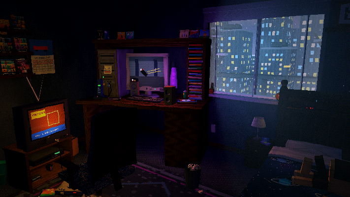
</div>

---

## 🆕 New in 1.3 — Goodnight, Jasper

<table>
<tr>
<td width="50%">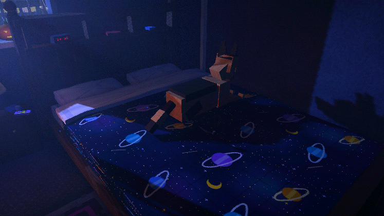<br><sub><b>Sleep mode</b>: one tap, lights down, Jasper curls up on the bed, everything fades out</sub></td>
<td width="50%">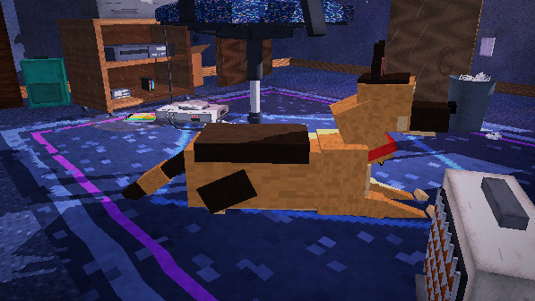<br><sub><b>Jasper</b>, rebuilt in chunky PS1 style. Pick his coat colours</sub></td>
</tr>
<tr>
<td width="50%">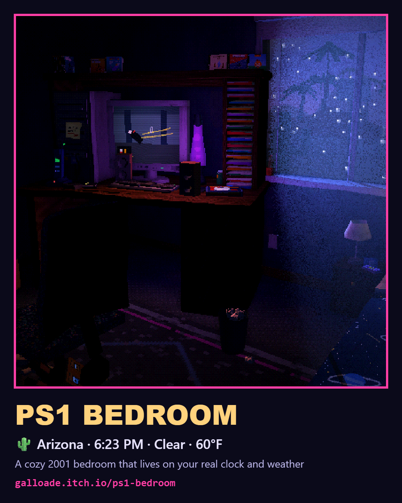<br><sub><b>Share cards</b>: a postcard of your room to post anywhere</sub></td>
<td width="50%" valign="top">

- ⏰ **Sunrise alarm**: the room glows warmer before your alarm, then your music plays
- 🏆 **18 achievements**
- 🎁 **Daily surprises** hidden in the room
- 🔇 Living room TV properly muffled · 📱 screen sleeps after the sleep timer
- 🛠️ Fixes: TV power, YouTube in Photo mode, chair, backpack, audio crackle

</td>
</tr>
</table>

## 🔜 Coming soon in 1.4

- 📅 A working wall calendar, with a little pixel-art design for every month
- 🕰️ A bedside clock you can read from the default view
- 🌌 A brand new seamless sky dome around the whole world
- 👆 Tap the top bar to switch time, weather and season, plus a new location button
- 🪚 Fixes: ceiling fan brackets, game shelf in front of the games
- 🚪 Later: the hallway comes back

Follow along on the **[1.4 milestone](../../milestone/1)**.

## New in 1.2

<div align="center">
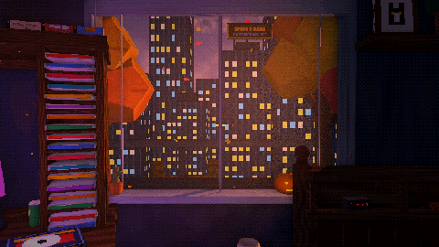
<br><sub><b>15 places outside the window</b>, each with its own sounds, climate and temperature</sub>
</div>

<br>

<table>
<tr>
<td width="50%">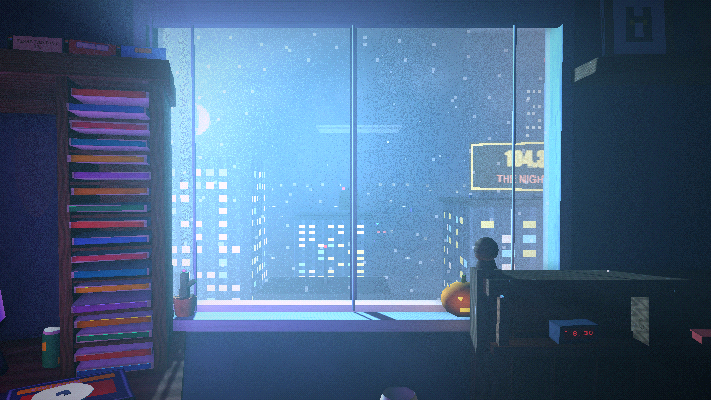<br><sub><b>Skyscraper, 40th floor</b>: rooftop billboards at eye level, the city grid far below</sub></td>
<td width="50%">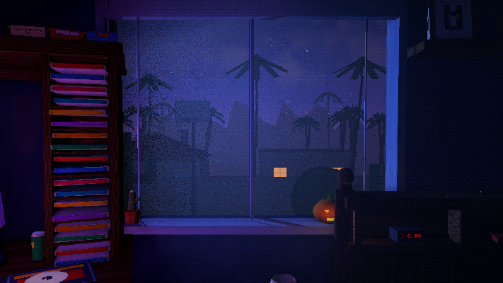<br><sub><b>Arizona</b>: block walls, fan palms, saguaros, monsoon dust storms, coyotes at night</sub></td>
</tr>
<tr>
<td width="50%">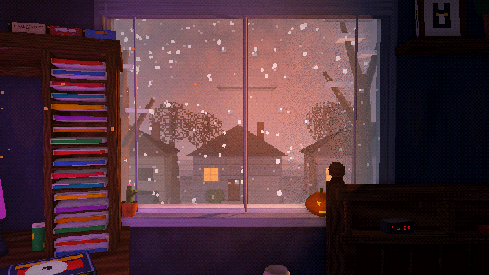<br><sub><b>Suburbs</b> in a snowfall, porch lights on</sub></td>
<td width="50%">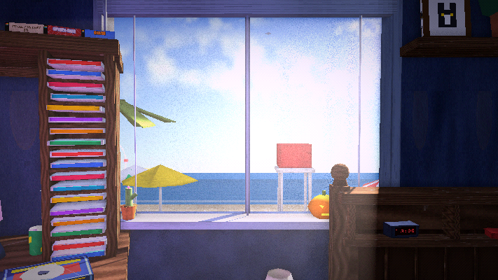<br><sub><b>Beach Boardwalk</b>: Ferris wheel, lighthouse, surf you can hear</sub></td>
</tr>
<tr>
<td width="50%">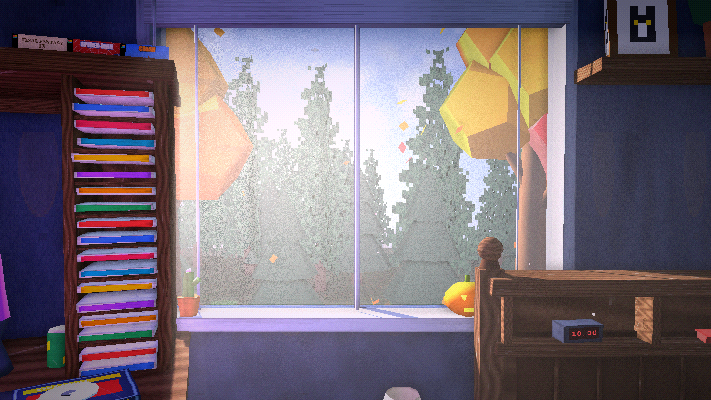<br><sub><b>Forest</b> in the morning mist</sub></td>
<td width="50%">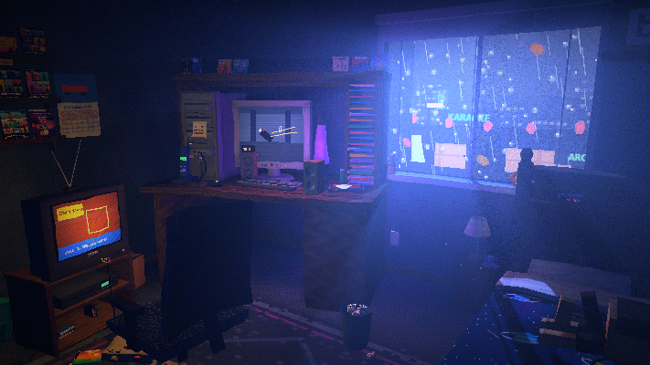<br><sub><b>Neon City</b> on a rainy night</sub></td>
</tr>
</table>

| | |
|---|---|
| 🏙️ **15 places outside** | Downtown · Skyscraper · Neon City · Neighborhood · Suburbs · Backyard · Trailer Park · Arizona · Desert Canyon · Tropical Island · Beach Boardwalk · Lakeside · Forest · Mountains · Countryside Farm |
| 🐕 **A German Shepherd** | Naps in the sunbeam, watches TV with you, sleeps on the bed. Blue eyes, his left one half brown. |
| 📻 **A real boombox player** | Your own albums with their cover art (it even shows on a CD case on the dresser), shuffle, repeat, FM stations |
| 📺 **YouTube on the CRT** | Paste a link, or Share a video to PS1 Bedroom on Android |
| 🖥️ **A working 2001 PC** | Instant messenger, WinBeats, Minesweeper, dial-up screech |
| 📼 **VCR, phone, decorations** | Tapes on channel 3, an answering machine, holiday decorations by date |
| ✨ **Better looking** | Per-pixel lighting, ambient occlusion, sharper shadows, a sky box with no edge of the world |
| 🔋 **Made for all night** | Stays smooth for hours: automatic quality, a 30/60/120 fps setting, eco idle, silent sounds switch off |

---

## ⬇️ Get it

<table>
<tr>
<td width="50%" valign="top">

### 📱 Android
1. Download **`PS1-Bedroom-v1.3.apk`** from the **[latest release](../../releases/latest)**.
2. Open it and tap **Install** (allow installs from your browser if asked).
3. If Play Protect warns you, tap **Install anyway**. It's just not from the Play Store.

Works great on a TV with **Samsung DeX**.

</td>
<td width="50%" valign="top">

### 💻 Browser
**[Play it right now](https://jenzimibruh.github.io/ps1-bedroom/play/)**, or download **`PS1-Bedroom-web-v1.3.zip`** from the release and open `index.html`.

Drag to look, scroll to zoom, WASD to walk.

</td>
</tr>
</table>

---

## ✨ Everything else

<table>
<tr>
<td width="50%">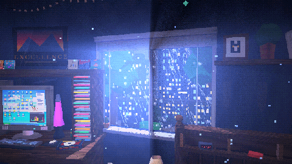<br><sub><b>15 weathers</b>, or live weather for your city</sub></td>
<td width="50%">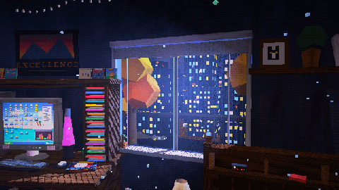<br><sub><b>Real sun and moon</b> paths and tonight's moon phase</sub></td>
</tr>
<tr>
<td width="50%">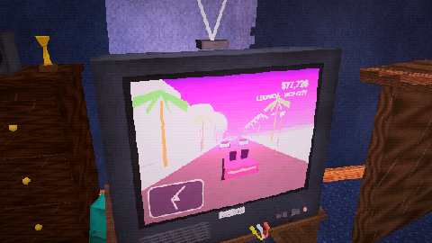<br><sub><b>A PlayStation full of games</b>, including every GTA as a tribute</sub></td>
<td width="50%">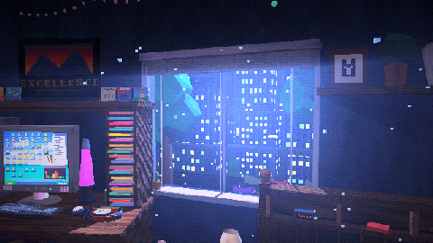<br><sub><b>Five skies</b>: Natural, Northern Lights, Meteor Shower, Blood Moon, Vaporwave</sub></td>
</tr>
</table>

- 🚶 Walk around, sit in the rolling chair, or lie in bed
- ⏾ Sleep timer that fades everything out · focus timer on the bedside clock
- 🔒 Android: background play, lock-screen controls, home-screen widgets
- 📷 Photo mode · 🎨 Looks (Raw PS1, Warm VHS, Neon Dream, Noir…) · 💾 remembers everything

---

## 📜 Changelog

Full history in **[CHANGELOG.md](CHANGELOG.md)** and in the app under **Menu → About**.

<details>
<summary><b>v1.3 — Goodnight, Jasper</b> (latest)</summary>

<br>

Sleep mode · sunrise alarm · share cards · 18 achievements · daily surprises · Jasper rebuilt with coat colours · muffled living room TV · screen sleeps after the timer · fixes for the TV, YouTube in Photo mode, chair, backpack and audio crackle

</details>

<details>
<summary><b>v1.2 — Stuff from 2001</b></summary>

<br>

15 places outside the window · German Shepherd · boombox player with albums and cover art · YouTube on the TV · working PC desktop · VCR tapes · phone and answering machine · traffic and billboards that follow the clock · decorations by date · focus timer · ambient occlusion · per-pixel lighting · sky box · 120 fps option · long-session performance fixes · audio clipping fix

</details>

<details>
<summary>Older versions</summary>

<br>

- **v1.1.4 — Temperature** · °F / °C in the top bar
- **v1.1.3 — Dust in the light** · dust follows the light beam
- **v1.1.2 — Little touches** · live bedside clock
- **v1.1.1 — Fixes** · light rays stay in the window, no more fall crackle
- **v1.1 — The living room update** · real sun and moon, 15 weathers, the GTA collection, Android widgets and lock screen
- **v1.0 — First full release**
- **v0.1 – v0.8** · alpha and beta

</details>

---

## 🔧 Build it yourself

<details>
<summary>Project layout and builds (Windows)</summary>

<br>

```
src/ps1_bedroom.html   ← the whole app (3D, sound, UI) in one file
android/               ← small WebView wrapper: service, widgets, bridge
Build APK.bat          ← builds releases/PS1-Bedroom-vX.Y.apk
tools/build-web.ps1    ← builds the browser zip and docs/play
```

No Gradle: the APK script runs `aapt2 → javac → d8 → zipalign → apksigner` directly. Bring your own keystore in `android/signing/`.

</details>

---

<div align="center">

<sub>Some props from <a href="https://kenney.nl/assets/furniture-kit">Kenney's Furniture Kit</a> (CC0) · Built with <a href="https://threejs.org/">three.js</a> and <a href="https://tonejs.github.io/">Tone.js</a> · Live weather by <a href="https://open-meteo.com/">Open-Meteo</a></sub>

<sub>Made by Daymion Gallo (Galloade / JenZiMiBruh). An unofficial fan project, not affiliated with Sony Interactive Entertainment, Rockstar Games or anyone else. Game boxes and covers are hand-drawn tributes. Your music stays on your device.</sub>

<br>

**🌙 Sweet dreams. 🎮**

</div>
