

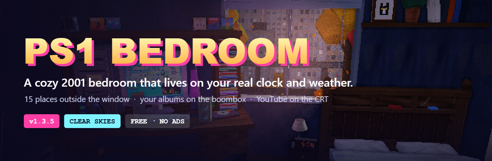

 

<h3><i>Your room. Your clock. Your weather. 2001 forever.</i></h3>

A cozy ambience app that looks like a PlayStation game from 2001. Leave it on while you study, work, game or fall asleep.

<a href="#-new-in-135--clear-skies">What's new</a> &nbsp;·&nbsp; <a href="#-the-room">The room</a> &nbsp;·&nbsp; <a href="#-15-places-outside">Places</a> &nbsp;·&nbsp; <a href="#%EF%B8%8F-get-it">Download</a> &nbsp;·&nbsp; <a href="#-made-for-android">Android</a> &nbsp;·&nbsp; <a href="#-changelog">Changelog</a> &nbsp;·&nbsp; <a href="../../wiki">📖 Wiki</a>

 

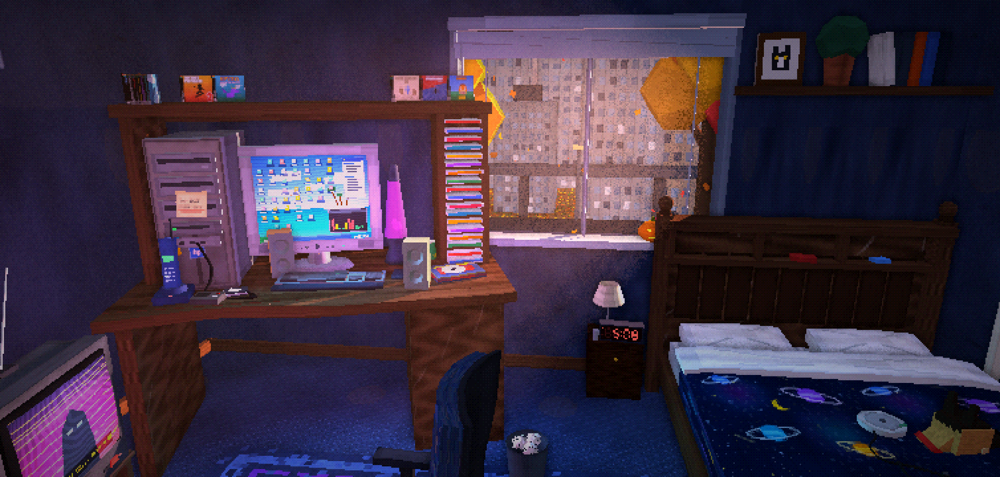

Golden hour downtown. The clock by the bed shows the room's real time.

 

> [!IMPORTANT]
> ### 🎃 OUT NOW: PS1 Bedroom Native for Android (v0.60.1 — Halloween Release)!
> PS1 Bedroom has been completely rebuilt from the ground up as a **pure native Android app in Kotlin + OpenGL ES 3.0**! No web view, no browser overhead — just butter-smooth, sleep-friendly retro perfection.
> 
> * ⚡ **Native Hardware Performance**: 60 / 90 / 120 fps pacing with smart thermal scaling and eco idle — your phone stays ice-cold overnight.
> * 🔊 **Crash-Proof Native 3D Audio**: Clean, spatial synth mixer with zero overnight crackle or clipping.
> * 📺 **Playable 3D Open-City GTAs**: Every GTA from III to VI is playable with authentic per-game HUDs, cars, traffic, and districts right on the bedroom CRT!
> * 👾 **Living Tamagotchu Virtual Pet**: Hatches, grows, eats, plays, sleeps, and poops on the real-world clock on the bedroom dresser.
> * 🐕 **Jasper German Shepherd**: Jointed PS1 model, custom coats, reactive room AI, and smart obstacle navigation.
> * 🗑️ **Paper Toss Deluxe & Gooey Lava Lamp**: Real marching-tetrahedra metaballs and a full paper-tossing mini-game.
> * 📱 **Android Power Features**: True background playback, lock screen player with cover art, and "My Window" + "Controls" home widgets.
> 📲 **[Download Native APK v0.60.1 (1.6 MB)](https://github.com/JenZiMiBruh/ps1-bedroom/releases/download/v0.60.1/PS1-Bedroom-native-v0.60.1.apk)** &nbsp;·&nbsp; **[View GitHub Release](../../releases/tag/v0.60.1)** &nbsp;·&nbsp; **[Explore the `native` branch](../../tree/native)**  
> *(Coming to Google Play before the end of 2026!)*

## 🆕 New in 1.3.5 — Clear Skies

<table>
<tr>
<td width="50%" valign="top">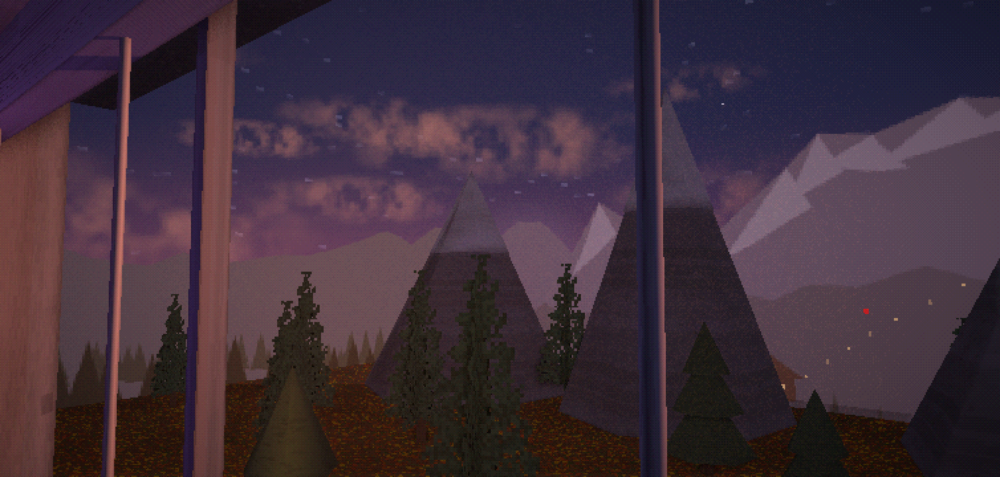 <b>🌌 A whole new sky</b> One seamless dome around the world, with the sun, moon, stars and clouds drifting all the way round. No more seams or corners.</td>
<td width="50%" valign="top">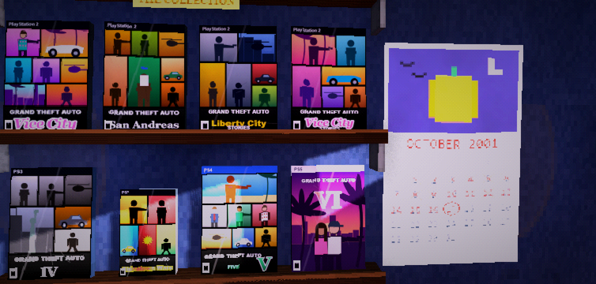 <b>📅 A calendar that works</b> The real month, today circled, past days crossed off, and a little pixel-art picture for every month.</td>
</tr>
<tr>
<td width="50%" valign="top">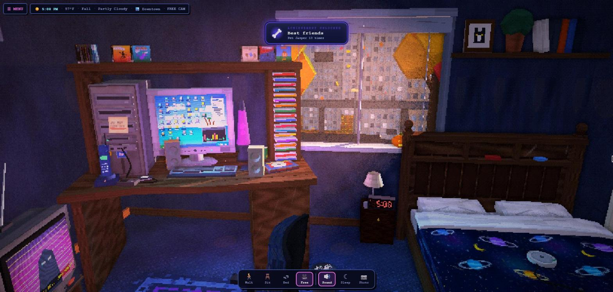 <b>🏆 Achievements you can feel</b> A trophy card, pixel confetti and a fanfare, with a different colour, move and tune for each one. Tap the top bar to flip time, weather, season and place.</td>
<td width="50%" valign="top">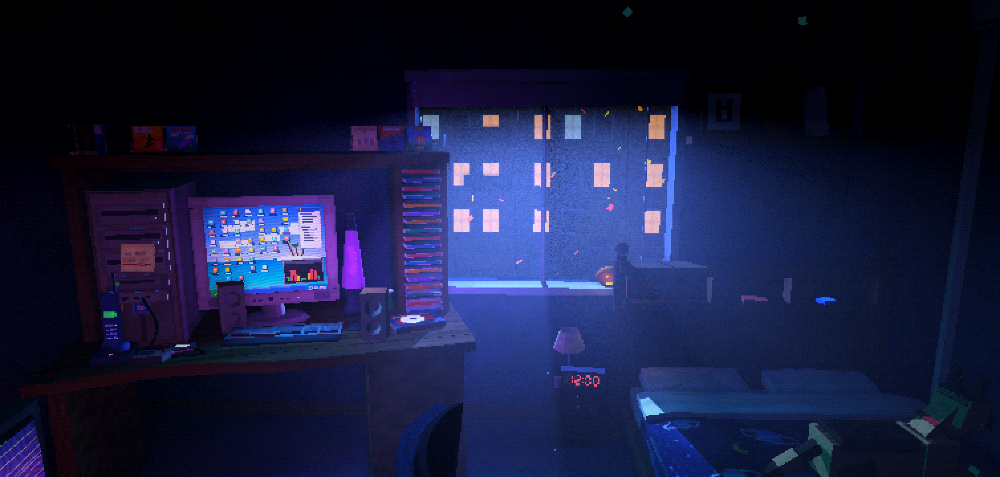 <b>🕰️ A clock you can read</b> A jumbo LED clock radio on the nightstand. Tap it for the sleep timer, focus timer and sunrise alarm.</td>
</tr>
</table>

<b>Everything else in 1.3.5</b>

 

- ✨ **Flicker fixed for good**: layered things (the TV border, posters, the album cover, the rug, windows on the houses outside) no longer fight, and small far-away things no longer vanish
- 📺 **PS1 look on YouTube**: the video wobbles with the TV and gets the room's chunky pixels (Menu → Display)
- 🔊 **New default sound mix**: your TV louder than the one down the hall, softer rain peaks
- 🔋 **Cooler phones**: 20 fps after 2 minutes untouched, fewer redraws, lighter audio
- 🐕 Jasper's neck, the ceiling fan brackets, the game shelf, the box fan and lots more fixed

 

## 🌙 The room

<table>
<tr>
<td width="33%" align="center" valign="top">🕰️ <b>Real time, real weather</b> The sun and moon follow your clock on real paths. It rains when it rains in your city. 15 weathers and 5 skies.</td>
<td width="33%" align="center" valign="top">🎮 <b>A PlayStation full of games</b> Put any game from the shelf in the PS1, including every GTA as a hand-drawn tribute.</td>
<td width="33%" align="center" valign="top">📻 <b>Your music on the boombox</b> Your own albums with their cover art, shuffle, repeat and FM stations. Your music never leaves your device.</td>
</tr>
<tr>
<td width="33%" align="center" valign="top">📺 <b>YouTube on the CRT</b> Paste a link, or Share a video to PS1 Bedroom on Android, and it plays on the old TV.</td>
<td width="33%" align="center" valign="top">🐕 <b>Jasper the German Shepherd</b> Naps in the sunbeam, watches TV with you, sleeps on the bed. Pick his coat colours.</td>
<td width="33%" align="center" valign="top">🖥️ <b>A working 2001 PC</b> Instant messenger, WinBeats, Minesweeper and the dial-up screech.</td>
</tr>
<tr>
<td width="33%" align="center" valign="top">😴 <b>Made for falling asleep</b> Sleep mode, a sleep timer that fades everything out, and a sunrise alarm.</td>
<td width="33%" align="center" valign="top">🔊 <b>Sound all around you</b> Rain on the glass, the CRT hum, the fan, crickets, a train going by. Every sound placed in 3D.</td>
<td width="33%" align="center" valign="top">📷 <b>Photo mode and share cards</b> Hide the UI, pick a look (Raw PS1, Warm VHS, Neon Dream, Noir…) and make a postcard of your room.</td>
</tr>
</table>

<table>
<tr>
<td width="50%">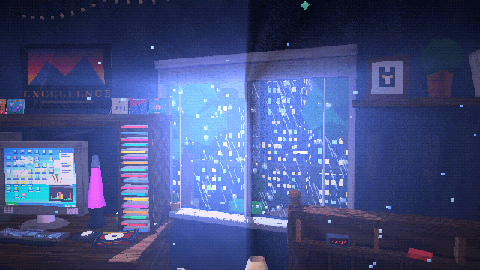 <b>15 weathers</b>, or live weather for your city</td>
<td width="50%">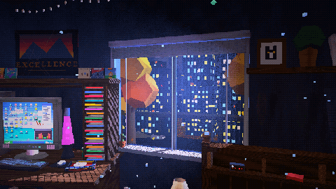 <b>Real sun and moon</b> paths and tonight's moon phase</td>
</tr>
<tr>
<td width="50%">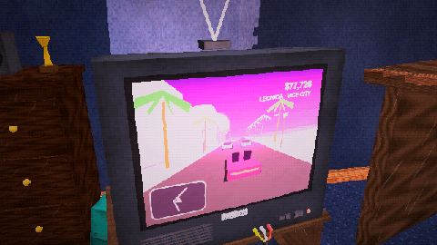 <b>Games on the CRT</b>, from the classics to GTA VI</td>
<td width="50%">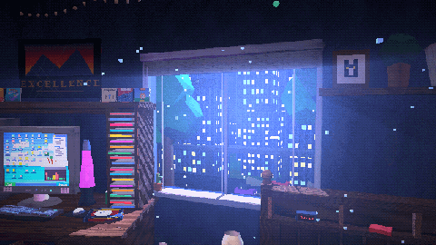 <b>Five skies</b>: Natural, Northern Lights, Meteor Shower, Blood Moon, Vaporwave</td>
</tr>
</table>

 

## 🏙️ 15 places outside

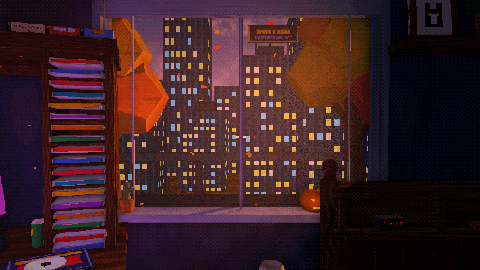

<table>
<tr>
<td width="33%">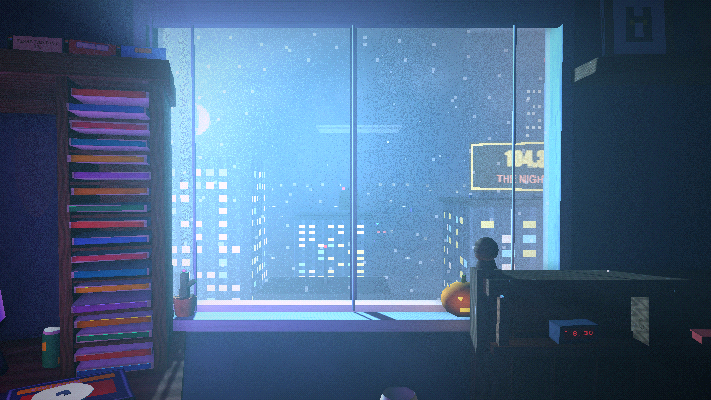 <b>Skyscraper</b>, 40th floor</td>
<td width="33%">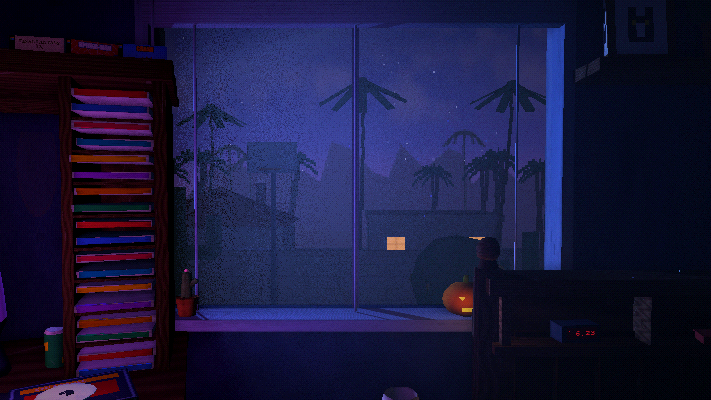 <b>Arizona</b> at dusk</td>
<td width="33%">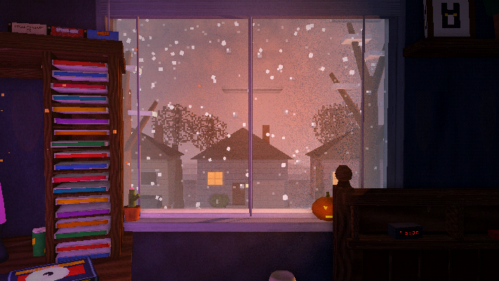 <b>Suburbs</b> in the snow</td>
</tr>
<tr>
<td width="33%">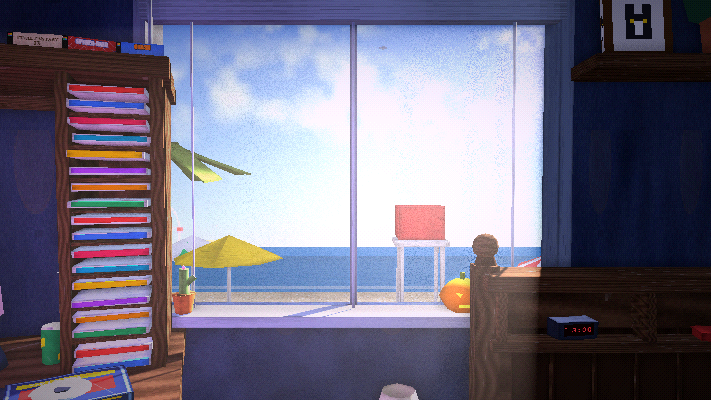 <b>Beach Boardwalk</b></td>
<td width="33%">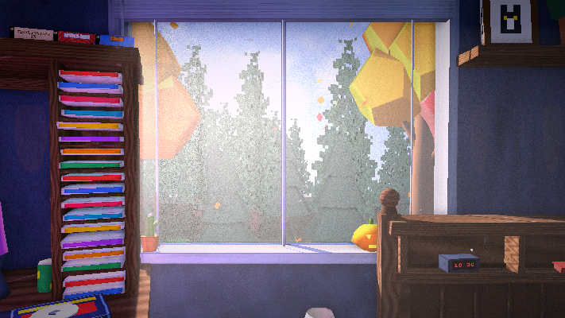 <b>Forest</b> in the mist</td>
<td width="33%">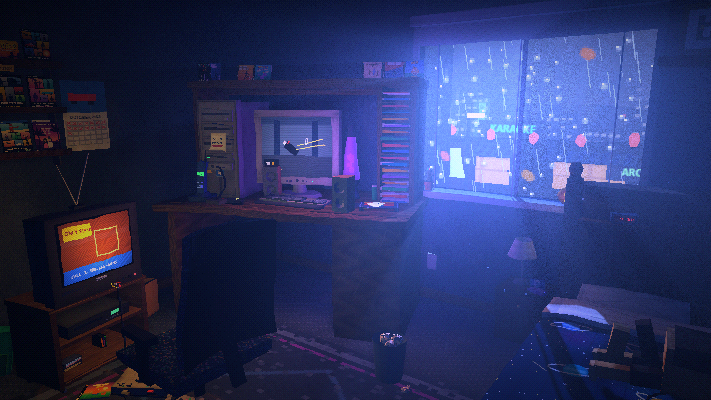 <b>Neon City</b> in the rain</td>
</tr>
</table>

Downtown · Skyscraper · Neon City · Neighborhood · Suburbs · Backyard · Trailer Park · Arizona · Desert Canyon · Tropical Island · Beach Boardwalk · Lakeside · Forest · Mountains · Countryside Farm

 

## ⬇️ Get it

<table>
<tr>
<td width="50%" valign="top">

### 📱 Android

[-22c55e?style=for-the-badge&logo=android&logoColor=white&labelColor=1a1033)](https://github.com/JenZiMiBruh/ps1-bedroom/releases/download/v0.60.1/PS1-Bedroom-native-v0.60.1.apk)

The native Android app is officially live! Built from scratch in **pure Kotlin + OpenGL ES 3.0**: cooler, lighter, crash-proof, and designed for all-night sleep ambience.

- 📲 **[Download PS1-Bedroom-native-v0.60.1.apk](https://github.com/JenZiMiBruh/ps1-bedroom/releases/download/v0.60.1/PS1-Bedroom-native-v0.60.1.apk)** (~1.6 MB)
- 🔋 **Battery & Sleep Friendly**: 60 / 90 / 120 fps pacing with eco idle — keeps your phone ice-cold for 8+ hours
- 🎮 **Playable CRT GTAs & Tamagotchu**: Full open-world 3D GTAs on the CRT and living virtual pet on the dresser
- 🐕 **Jasper German Shepherd**: Jointed PS1 model with reactive AI, coat swatches, and smart obstacle avoidance
- ▶️ **Google Play** before the end of 2026

- 📦 **Offline & Lightweight**: No browser engine or heavy dependencies; works on Android 7.0 through Android 15.
- 🛠️ Follow the continuous native development on the [`native` branch](../../tree/native).

</td>
<td width="50%" valign="top">

### 💻 Browser

Nothing to install. Or download **`PS1-Bedroom-web-v1.3.5.zip`** from the release and open `index.html`.

**Drag** to look · **scroll** to zoom · **WASD** to walk · tap anything

Also on **[itch.io](https://galloade.itch.io/ps1-bedroom)**.

</td>
</tr>
</table>

 

## 📱 Made for Android

Available now in the native Android app (v0.60.1)!

| | |
|---|---|
| 🔒 **Background play** | Keeps playing with the screen off, with song, artist and cover on the lock screen |
| 🧩 **Widgets** | "My Window" and "Controls" widgets for your home and lock screen |
| 📺 **Samsung DeX** | Turns your TV into a rainy 2001 window |
| 📤 **Share to play** | Share a YouTube video to PS1 Bedroom and it plays on the CRT |
| 🔋 **All-night battery** | Automatic quality, a 30 / 60 / 120 fps setting and an eco idle mode, so it stays cool for hours |
| 🎵 **Your albums** | Add album folders and it reads the track order and cover art. Your music stays on your device |
| 👾 **Living Tamagotchu** | Authentic virtual pet on the dresser: hatches, grows, plays, gets hungry, and sleeps on the real clock |
| 🎮 **Playable CRT Games** | Pick up the controller and drive around open-city 3D GTAs with authentic HUDs and pause maps |
| 🐕 **Smart Jasper AI** | German Shepherd with coat swatches, reactive room AI, and seamless obstacle pathfinding |

 

## 🔜 Roadmap & Upcoming Milestones

### 🚀 Major Additions & Long-Term Overhauls

- 🚪 **The Full Hallway & Apartment Expansion**: Step through the bedroom door into the wood-paneled 2001 apartment hallway. Explore the midnight kitchen (humming fridge, glowing digital microwave, late-night snacks & Surge soda), retro bathroom, and cozy living room couch where Jasper follows and curls up beside you.
- 📻 **Live Web Radio & 24/7 Lo-Fi Streamer**: Connect the boombox to real live Shoutcast/Icecast retro radio stations, 24/7 Lo-Fi chill beats, ambient rain streams, synthwave, and live NOAA weather radio with analog frequency tuning.
- 🍂 **Living Four-Season Micro-Climate Overhaul**: Continuous, gradual seasonal transitions. Autumn leaf-raking piles in suburban yards; dynamic winter snow accumulation on window sills, roofs, and car windshields; springtime cherry blossom flurries; humid summer night cicadas and distant thunderstorm heat lightning.
- 📼 **VCR Camcorder & Magnetic VHS Recording Engine**: Record CRT gameplay, live window weather, or bedroom views onto virtual VHS tapes with authentic tracking flutter, scanline glitch, head chatter, tape hiss, and timestamp overlay ("REC ⏺ OCT 31 2001").
- 🐕 **Jasper Companion 2.0**: Trick training (fetch tennis ball, roll over, shake paw), dog toy box with squeaky physics toys, feeding/water bowls, and backyard leash walks.
- 🖥️ **RetroOS 2001 PC Expansion**: 56k dial-up connection with screeching modem handshake audio, Instant Messenger buddy list with nostalgic sounds, simulated 2000s web browser with retro fansites and cheat codes, and playable 3D Pinball / Solitaire.
- 🌦️ **Interactive Doppler Radar & Emergency Alert System (EAS)**: High-resolution Doppler radar loop on the CRT TV weather channel showing incoming storm cells, paired with atmospheric sirens and cozy thunderstorm weather reports.
- 🕹️ **Full Bluetooth Gamepad & Controller Support**: Native DualShock 4, DualSense, Xbox, and 8BitDo wireless controller support for room traversal, camera orbit, and full analog CRT GTA driving.
- 🛋️ **Modular Bedroom Interior Customizer**: Grid-based furniture rearrangement (swap bed and desk spots, rotate the TV cart), custom bedding, vintage wallpapers, and hangable corkboard for sticky notes and polaroids.
- 👥 **Passive Ambient Co-Presence ("Midnight Study Session")**: Optional lightweight multiplayer to share a 4-word room code with a friend to study together in synchronized real-time weather and boombox soundscapes.

 

### 💡 Creative Ideas & Feature Wishlist

<table>
<tr>
<td width="50%" valign="top">

- 🛹 **Backyard Skate Minigame**: Fingerboard / mini skateboard trick ramp on the desk or driveway
- 📻 **Cassette Tape Mixtape Maker**: Record boombox songs onto blank cassette tapes with hand-written Sharpie labels
- 🐱 **A Stray Cat on the Fire Escape**: An inquisitive neighborhood cat that visits the windowsill or fire escape during quiet nights
- 🐟 **Virtual Aquarium / Fish Bowl**: Low-poly neon tetras swimming on the desk shelf with gentle bubbling aerator sound
- 🔦 **Nighttime Flashlight & Laser Pointer**: Interactive flashlight beam to explore dark room corners and play with Jasper

</td>
<td width="50%" valign="top">

- 🥪 **Late-Night Snack System**: Grab pizza, Surge, or snacks from the kitchen or desk stash
- 🌧️ **Micro-Weather Transitions**: Watch distant storm fronts visibly roll in across the horizon before rain reaches the glass
- 🛸 **Late-Night Paranoias & Mysteries**: Rare eerie phenomena (subtle UFO lights over distant mountains, mysterious numbers station on the radio)
- 🖨️ **Dot-Matrix / BubbleJet Desk Printer**: Print out ASCII art banners, achievement certificates, or cheat codes from the PC
- 📷 **Disposable Camera Album**: Snap 24 retro grainy disposable camera photos and get them "developed" on the desk

</td>
</tr>
</table>

Got an idea? **[Open an issue](../../issues/new)**. Follow along on the **[ideas list](../../issues?q=is%3Aissue+is%3Aopen+label%3Aidea)**, the **[milestones](../../milestones)** and the **[`native`](../../tree/native)** branch.

 

### 🎉 Recently Shipped in Native Android (v0.60.1)

A huge batch of top community-requested features have officially arrived in the new Native Android release:

- ✅ 🎮 **[Real games to play on the TV and the PC](../../issues/16)**: Playable 3D open-city GTAs (III through VI) on the CRT with authentic HUDs and cars; Paper Toss Deluxe; living Tamagotchu virtual pet on dresser; retro PC desktop mini-games.
- ✅ 🕹️ **[PS1 to PS5 consoles with their own boot-ups](../../issues/23)**: Authentic startup sounds and 3D console models for PS1, PS2, PS3, PS4, and PS5.
- ✅ ✨ **[A start screen that matches your PlayStation](../../issues/24)**: Full-screen authentic PS1 boot sequence on launch.
- ✅ 🫧 **[Turn the lava lamp on and off](../../issues/20)**: Interactive toggle switch with real marching-tetrahedra metaball wax.
- ✅ 🌧️ **[Better raindrops on the glass](../../issues/27)**: Physical multi-tier raindrops and snowflakes with live wind deflection and blowing indoor leaves.
- ✅ 🧱 **[Better wall textures](../../issues/28)**: Seamless, distortion-free UV coordinates across the entire room.
- ✅ 🎉 **[Better decorations and more holidays](../../issues/26)**: Date-based holiday string lights (Halloween, Christmas, etc.), wall posters, and room colours.
- ✅ 🖼️ **[Your own photos on posters](../../issues/18)** & 📻 **[Poster options above the boombox](../../issues/19)**: Custom photo gallery loading and switchable posters.
- ✅ 📺 **[Move and hide the YouTube buttons](../../issues/21)**: Seamless CRT YouTube integration with customizable controls.
- ✅ 🐾 **[More animals and dog breeds](../../issues/17)**: Coat variations for Jasper, reactive thunder/music AI, and obstacle-avoidance pathfinding.

 

## 📜 Changelog

Full history in **[CHANGELOG.md](CHANGELOG.md)** and in the app under **Menu → About**.

<b>v1.3.5 — Clear Skies</b> (latest)

 

New seamless sky dome · working wall calendar · LED clock radio by the bed · tap the top bar to switch time, weather, season and place · achievement unlock animations and fanfares · PS1 look on YouTube · new sound mix · cooler on phones · flicker and vanishing fixed for good · Jasper's neck, ceiling fan, game shelf, box fan and more

<b>v1.3 — Goodnight, Jasper</b>

 

Sleep mode · sunrise alarm · share cards · 18 achievements · daily surprises · Jasper rebuilt with coat colours · muffled living room TV · screen sleeps after the timer · fixes for the TV, YouTube in Photo mode, chair, backpack and audio crackle

<b>v1.2 — Stuff from 2001</b>

 

15 places outside the window · German Shepherd · boombox player with albums and cover art · YouTube on the TV · working PC desktop · VCR tapes · phone and answering machine · traffic and billboards that follow the clock · decorations by date · focus timer · ambient occlusion · per-pixel lighting · sky box · 120 fps option · long-session performance fixes · audio clipping fix

Older versions

 

- **v1.2.1 — TV power** · a big red power button
- **v1.1.4 — Temperature** · °F / °C in the top bar
- **v1.1.3 — Dust in the light** · dust follows the light beam
- **v1.1.2 — Little touches** · live bedside clock
- **v1.1.1 — Fixes** · light rays stay in the window, no more fall crackle
- **v1.1 — The living room update** · real sun and moon, 15 weathers, the GTA collection, Android widgets and lock screen
- **v1.0 — First full release**
- **v0.1 – v0.8** · alpha and beta

 

---

Some props from <a href="https://kenney.nl/assets/furniture-kit">Kenney's Furniture Kit</a> (CC0) · Built with <a href="https://threejs.org/">three.js</a> and <a href="https://tonejs.github.io/">Tone.js</a> · Live weather by <a href="https://open-meteo.com/">Open-Meteo</a>

An unofficial fan project, not affiliated with Sony Interactive Entertainment, Rockstar Games or anyone else. Game boxes and covers are hand-drawn tributes. Your music stays on your device.

 

**Made by Daymion Gallo** · aka **Galloade** · aka **JenZiMiBruh**

🌙 *Sweet dreams.* 🎮

